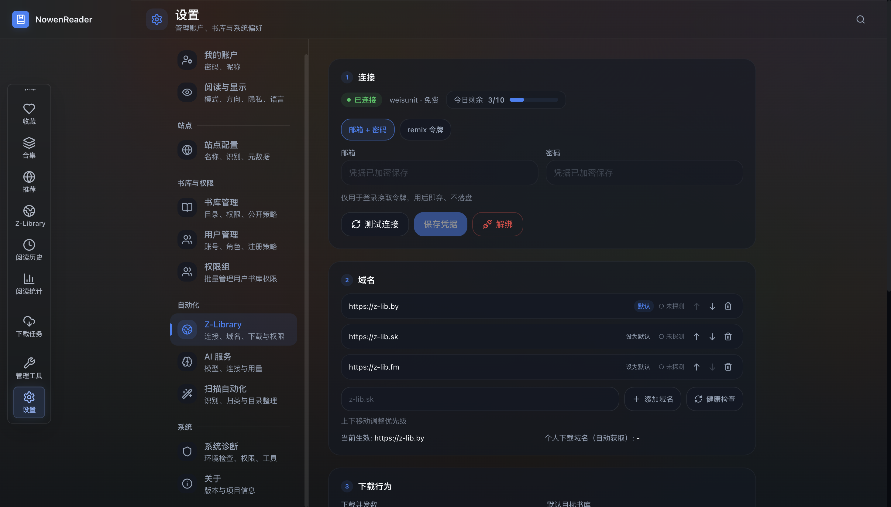

<h1 align="center">ZlibReader</h1>

<p align="center">
  
  
  
  
</p>

<p align="center">
  <strong>自托管书库平台 · 集成 Z-Library 搜索与一键入库</strong><br>
  搜书 → 一键入库 → 在线阅读，全程不离开平台
</p>

<p align="center">
  基于 <a href="https://github.com/cropflre/nowen-reader">NowenReader</a>（弄文阅读）深度二次开发，
  遵循 <a href="./LICENSE">GPL-3.0</a> 开源 · 上游升级兼容性设计见 <a href="./docs/PLUGIN.md">docs/PLUGIN.md</a>
</p>

---

## 这是什么

ZlibReader 是一个自托管的书库管理与阅读平台。它继承了 [NowenReader](https://github.com/cropflre/nowen-reader) 的全部核心能力（漫画/小说书库管理、多格式阅读器、元数据刮削、多用户权限、OPDS、AI 辅助、PWA），并在此之上以**插件化模块**集成了 **Z-Library 搜索与一键入库**：

```
Z-Library 搜索 → 点击入库 → 自动下载 → 自动扫描 → 元数据回填 → 在线阅读
```

> **合规声明**：本项目仅供个人学习与研究。Z-Library 内容版权归原权利人所有，
> 使用本工具时请遵守你所在地区的法律法规及 Z-Library 服务条款。
> 本项目不分发任何书籍内容，也不内置任何账号。

## 界面预览

**Z-Library 搜索 —— 封面网格 / 配额 / 一键入库 / 已入库标记**


**设置 —— 连接 / 域名容灾 / 下载行为 / 权限 / 兜底指引**



## 新增能力（Z-Library 插件）

- **站内搜索**：书名/作者关键词，语言、格式（EPUB/PDF/MOBI/CBZ/ZIP…）、年份、排序筛选，封面网格/列表双视图
- **一键入库**：配额预检 → 去重校验 → 流式下载（进度实时可见）→ 文件校验 → 规范化命名落盘 → 自动扫描入库
- **任务中心**：全局抽屉 + 角标，进度/阶段/失败原因可视化，支持重试与取消
- **智能路由**：漫画（CBZ/CBR/ZIP/RAR/7Z）自动进漫画书库，电子书（EPUB/TXT…）自动进小说书库，PDF 双栖可手动指定
- **配额管理**：每日额度可视化（免费账号约 10 本/天），超限明确提示
- **域名容灾**：多镜像健康检查 + 自动故障转移；下载通道支持借用浏览器通行证（详见设置页说明）
- **去重**：同书同格式重复入库自动拦截，本地删除后可重新入库
- **权限分档**：管理员 / 可管理书库者 / 全体用户 三档可见性

## 继承自上游的能力

书库管理（多书库/标签/合并分组/重复检测）、多格式阅读器（单双页/条漫/Webtoon/书签）、
元数据刮削（AniList/Bangumi/MangaDex 等 5 源 + ComicInfo.xml）、AI 辅助（17+ 供应商）、
OPDS（KOReader/Moon+ Reader）、多用户权限、PWA、中英日三语。

详见上游项目 [README](./README.upstream.md) 与 [docs/](./docs/)。

## 快速开始

### 方式 A · docker-compose（推荐）

仓库自带 `docker-compose.yml`（已指向 GHCR 预构建多平台镜像，自动匹配 amd64/arm64），数据目录、端口、重启策略全部配置好：

```bash
mkdir zlib-reader && cd zlib-reader
# 下载 compose 文件（或 git clone 本仓库）
curl -LO https://raw.githubusercontent.com/weisunit/zlib-reader/main/docker-compose.yml

docker compose up -d          # 自动拉取镜像并启动
# 打开 http://localhost:6680 → 注册管理员（首个用户自动成为管理员）
```

常用操作：

```bash
docker compose pull && docker compose up -d   # 升级到最新镜像
docker compose logs -f                        # 看日志
docker compose down                           # 停止（数据保留在 ./data ./comics ./novels ./cache）
```

**需要出站代理的网络环境**（Z-Library 等国际站点不可直连时）：不要改 `docker-compose.yml`，
在同目录创建 `docker-compose.override.yml`（compose 会自动合并，且该文件名已被 gitignore）：

```yaml
services:
  nowen-reader:
    environment:
      - HTTPS_PROXY=http://192.168.x.x:10808   # 你的代理地址
      - HTTP_PROXY=http://192.168.x.x:10808
      - NO_PROXY=localhost,127.0.0.1,bigmodel.cn,.bigmodel.cn
```

然后 `docker compose up -d` 重启生效。

### 方式 B · docker run

```bash
docker pull ghcr.io/weisunit/zlib-reader:latest

docker run -d --name zlib-reader --restart unless-stopped -p 6680:3000 \
  -e DATABASE_URL=/data/nowen-reader.db -e COMICS_DIR=/app/comics \
  -e NOVELS_DIR=/app/novels -e DATA_DIR=/app/.cache -e PORT=3000 \
  -v $PWD/data:/data -v $PWD/comics:/app/comics \
  -v $PWD/novels:/app/novels -v $PWD/cache:/app/.cache \
  ghcr.io/weisunit/zlib-reader:latest
```

### 方式 C · 本地构建

```bash
git clone https://github.com/weisunit/zlib-reader.git && cd zlib-reader
docker build -t zlib-reader:latest .
docker tag zlib-reader:latest ghcr.io/weisunit/zlib-reader:latest
docker compose up -d --no-build

### NAS（群晖）部署要点

群晖实测经验（v1.0.1 起已内置引导，以下仍建议照做）：

```bash
# 1. 群晖 docker 不会自动创建 bind mount 目录，先手动建（否则 up 失败）
sudo mkdir -p /volume1/docker/zlib-reader/{data,comics,novels,cache}
cd /volume1/docker/zlib-reader
# 2. 下载 compose（群晖 sshd 默认无 SFTP，scp 记得加 -O）
sudo curl -L -o docker-compose.yml https://raw.githubusercontent.com/weisunit/zlib-reader/main/docker-compose.yml
# 3. 群晖的 docker 需要 sudo，且容器路径用全量二进制
sudo /usr/local/bin/docker-compose up -d
```

- 首个注册用户自动成为管理员；应用首启会**自动创建「小说书库」**（上游默认只建漫画库，ZlibReader 引导补齐）
- 出站代理：在 NAS 上创建 `docker-compose.override.yml`（模板见「方式 A」代理说明），代理地址须为 **NAS 可达**的地址
- 下载被反爬拦截时：设置 → Z-Library → 下载通道，粘贴浏览器 Cookie 串与 User-Agent（获取方法见界面提示）

# 3. 打开 http://localhost:6680 → 注册管理员（首个用户自动成为管理员）
# 4. 设置 → Z-Library → 连接：填入 Z-Library 账号（或浏览器 remix 令牌）
# 5. 搜索页搜书 → 点「入库」→ 任务中心看进度 → 书库阅读
```

> 详细部署（NAS/反代/子路径）与配置说明见 [docs/INSTALL.md](./docs/INSTALL.md)、
> [docs/CONFIGURATION.md](./docs/CONFIGURATION.md)。
> 中国大陆网络环境提示：Z-Library 访问通常需要代理，容器已支持 `HTTPS_PROXY` 环境变量。

## Z-Library 插件架构（上游升级友好）

所有 Z-Library 相关代码以**自包含模块**组织，对上游的修改压缩到个位数行级接线点：

| 层 | 位置 | 上游修改 |
| --- | --- | --- |
| 适配层 | `internal/zlibrary/`（纯新增） | 无 |
| 业务层 | `internal/zlibrary/service/`（纯新增） | 无 |
| 存储 | `internal/store/zlibrary_store.go` + `migrate_zlibrary_plugin.go`（纯新增） | 无（迁移独立注册） |
| HTTP | `internal/handler/zlibrary_handler.go` + `routes_zlibrary.go`（纯新增） | 无 |
| 接线 | `router.go` +1 行、`main.go` +2 行 | 唯一后端侵入 |
| 前端 | `app/zlibrary/`、`components/zlibrary/`、`api/`、`hooks/`（纯新增） | 无 |
| 前端接线 | `main.tsx`/`DesktopSidebar`/`DashboardTopBar`/`settings` 各 5 处 `// s-library:` 标记 | 已标注 |

升级手册（含逐点核对清单）：[docs/PLUGIN.md](./docs/PLUGIN.md)。

## 开发

```bash
# 后端
go build ./... && go test ./...

# 前端（源码在 frontend/，构建产物经 scripts/copy-dist.mjs 拷入 web/dist 供 go:embed）
cd frontend && npm install && npm run build:all && npm run lint

# 本地联调跑服务（前端已构建入 embed）
GOPROXY=https://goproxy.cn,direct go run ./cmd/server
```

## 目录结构（新增部分）

```
internal/zlibrary/            # eapi 适配层（域名容灾/认证/搜索/下载/加解密）
internal/zlibrary/service/    # 任务队列/流水线/配额/去重/设置
internal/handler/zlibrary_*   # HTTP 层（12 端点）
internal/store/zlibrary_*     # 三张表 CRUD + 独立迁移注册
frontend/src/app/zlibrary/    # 搜索页
frontend/src/components/zlibrary/  # 结果卡/详情抽屉/任务中心/设置面板
docs/PLUGIN.md                # 插件架构与上游升级手册
```

## 协议与致谢

- 本项目遵循 **GPL-3.0** 协议开源，完整文本见 [LICENSE](./LICENSE)
- 上游项目 [NowenReader](https://github.com/cropflre/nowen-reader)（&#169; Nowen 开源实验室）——
  本项目全部核心能力的基础，致敬
- Z-Library 社区的 eapi 逆向文档与工具：
  [baroxyton/zlibrary-eapi-documentation](https://github.com/baroxyton/zlibrary-eapi-documentation)、
  [heartleo/zlib](https://github.com/heartleo/zlib)、
  [bipinkrish/Zlibrary-API](https://github.com/bipinkrish/Zlibrary-API)

## Star History

如果这个项目对你有帮助，欢迎给上游 [NowenReader](https://github.com/cropflre/nowen-reader) 点 Star——
本项目的每一行代码都站在它的肩膀上。
